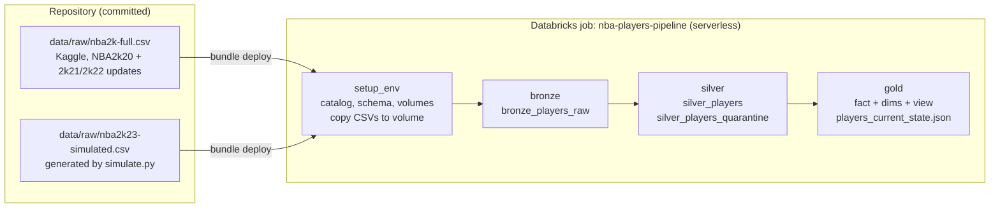
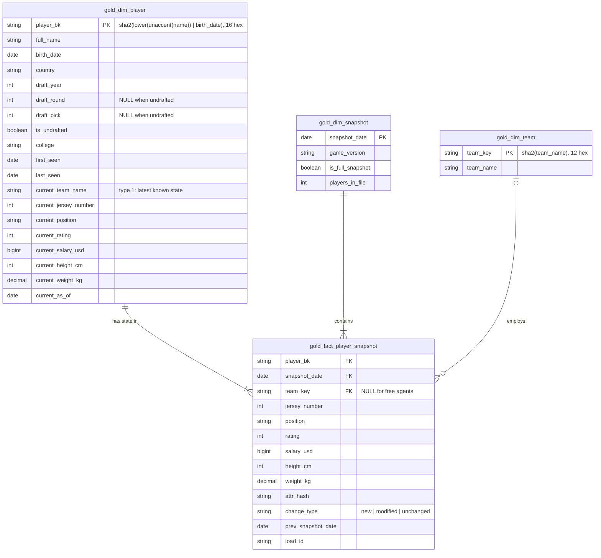

# NBA players pipeline

Incremental medallion pipeline (bronze, silver, gold) over the [NBA 2K player dataset](https://www.kaggle.com/datasets/isaienkov/nba2k20-player-dataset). It ingests point-in-time snapshots of the league, tells new, unchanged and modified players apart across loads, keeps the full history in a star schema and publishes the current state as JSON. Built for the ImagineX Data Engineering code test.

Everything a reviewer needs runs inside one Docker image, on any operating system: the tests, the snapshot simulator and the Databricks CLI that deploys and runs the job. The pipeline itself executes on Databricks serverless as a Databricks Asset Bundle.

## Contents

- [Quick start](#quick-start)
- [Architecture](#architecture)
- [Data model](#data-model)
- [Record identification and history](#record-identification-and-history)
- [Snapshots](#snapshots)
- [Data quality](#data-quality)
- [Tests](#tests)
- [Repository layout](#repository-layout)
- [Design decisions and trade-offs](#design-decisions-and-trade-offs)
- [Known limitations](#known-limitations)
- [Scaling and production evolution](#scaling-and-production-evolution)

## Quick start

Requirements: Docker Desktop (any OS) and, to run the job, a Databricks workspace. The Free Edition works; the job creates its own catalog, schema and volumes.

The commands below are plain `docker compose`, so they are identical in PowerShell, macOS and Linux. `make` only exists inside the container.

```bash
cp .env.example .env
```

Fill in `DATABRICKS_HOST` and `DATABRICKS_TOKEN` (a personal access token). Leave them empty if you only want tests and the simulator.

```bash
docker compose build
```

Builds the toolchain image: Python 3.11, a Java runtime for local PySpark, the Databricks CLI, and this project with its test dependencies. The first build takes a few minutes.

```bash
docker compose run --rm pipeline make test
```

Runs the whole suite on a local Spark (unit tests plus an oracle test that replays the committed snapshots through the real transformation code). No workspace needed.

```bash
docker compose run --rm pipeline make deploy
```

Uploads the code, the CSVs in `data/raw` and the job definition to the workspace.

```bash
docker compose run --rm pipeline make run-all
```

Runs the job once per snapshot file: first the initial file, then every `*-simulated.csv` in `data/raw` in name order (one today). After that, `gold_v_player_current` holds the current state of every player, `gold_fact_player_snapshot` the history with `change_type` per player and snapshot, and `/Volumes/imaginex/nba/output_files/players_current_state.json` the JSON export.

Other useful commands:

| Command | What it does |
|---|---|
| `docker compose run --rm pipeline make help` | List every target |
| `docker compose run --rm pipeline make run SOURCE_FILE=nba2k23-simulated.csv ON_FAILURE=fail` | Run the job for one file, stopping if any row is quarantined |
| `docker compose run --rm pipeline make simulate` | Regenerate the simulated snapshot from its seed |
| `docker compose run --rm pipeline make validate` | Check the bundle definition without deploying |
| `docker compose run --rm pipeline make plan` | Show what a deploy would create, update or leave untouched |
| `docker compose run --rm pipeline bash` | A shell inside the container with the repo mounted at `/app` |

The repo is mounted into the container, so files written there (a regenerated snapshot, test caches) land in your working copy. Line endings are pinned to LF by `.gitattributes`; if you edit `.env` on Windows, keep it LF too.

Running natively on macOS or Linux is also possible with `make install` (creates `.venv`) plus a Java 17 runtime, but Docker is the supported path.

## Architecture



One job, four tasks, one parameter that matters: `source_file`. Each run processes one CSV end to end. Running the same file again is a no-op at every layer; running a new file adds its snapshot on top of what is there.

**Setup.** Creates `imaginex.nba`, the `source_data` and `output_files` volumes if they do not exist, and copies the committed CSVs into the source volume. Runs from serverless SQL rather than from the bundle because catalog creation on Free Edition needs the workspace's default storage, which only SQL knows how to assign. Result: deploy, run, nothing by hand.

**Bronze.** The CSV is copied as-is: every column as text, one row per file line, plus lineage (`source_file`, `load_id`, `ingested_at`, `row_hash`). The header is compared against the expected 15 columns before reading, because Spark assigns by position when given a schema and a swapped column would load silently. Malformed lines land in `_corrupt_record` instead of failing the load. The write uses `replaceWhere source_file = ...`, so a rerun replaces exactly this file's rows.

**Silver.** Rows become typed and validated. Heights to centimeters, weights to kilograms, salaries to integers, two-digit birth years through a century pivot, a stable `player_bk`, a `snapshot_date` derived from the game version, and an `attr_hash` over the attributes that may change between snapshots. Every row is checked against the [quality rules](#data-quality). Clean rows go to `silver_players`, the rest to `silver_players_quarantine` with the failed rules and the original text. Same `replaceWhere` idempotency as bronze.

**Gold.** For each snapshot in the file, oldest first: upsert `gold_dim_team` and `gold_dim_snapshot`, classify each incoming row against the player's latest earlier row in the fact (`new`, `modified`, `unchanged`), replace that snapshot's partition of `gold_fact_player_snapshot`, and merge `gold_dim_player`, which carries the static attributes plus the current state. Finally the current-state view is exported to a single JSON file in the output volume.

All parsing runs under ANSI SQL mode, which is what serverless enforces: a malformed cast raises instead of returning NULL. The parsers therefore use `try_cast` and regex extraction so that bad input becomes NULL and is judged by the quality rules, never an exception.

## Data model



| Table / view | Grain | Notes |
|---|---|---|
| `bronze_players_raw` | one file line | all text, lineage columns |
| `silver_players` | one player per snapshot | typed, validated, `attr_hash` |
| `silver_players_quarantine` | one rejected row | failed rules + raw text |
| `gold_fact_player_snapshot` | one player per snapshot | history; liquid clustering on `(snapshot_date, player_bk)` |
| `gold_dim_player` | one player | static attributes + type-1 current state; clustered on `player_bk` |
| `gold_dim_team` | one team | surrogate key from the name |
| `gold_dim_snapshot` | one snapshot | when, which version, how many players |
| `gold_v_player_current` | one player | view over `gold_dim_player`; source of the JSON |

Normalization decisions: the fact keeps only the attributes that move between snapshots, so `SELECT ... WHERE snapshot_date = X` is a complete roster without joins to the history. Static attributes (birth date, draft, college) live once in the player dimension. The current state is denormalized into that same dimension so "who is on which team today" is a scan of a few hundred rows instead of a window over the fact, and the view exists so consumers do not depend on the `current_*` naming.

## Record identification and history

**Same entity across loads.** The source has no player id. The business key is `player_bk = sha2(lower(unaccent(full_name)) || '|' || birth_date)`, truncated to 16 hex characters. Name plus birth date survives trades, jersey changes and respellings (`Luka Doncic` and `Luka Dončić` hash the same), and separates players who share a name. It is built in silver, so every layer above agrees on it.

**What counts as a change.** `attr_hash` covers exactly the mutable columns: team, jersey, position, rating, salary, height, weight. A typo fix in `college` does not make a player look modified; a trade does. NULL hashes as empty string, so a free agent stays stable across loads.

**History strategy.** The fact is snapshot-based: one row per player per snapshot, append-only by snapshot, with `change_type` and `prev_snapshot_date` precomputed. It is the equivalent of a type-2 history where validity is bounded by consecutive snapshot dates, and it answers "what did the roster look like on 2020-09-04" or "who was traded between 2021 and 2022" with a filter and no interval logic. The player dimension is type 1: latest known state, `first_seen` and `last_seen`.

**Reprocessing.** Each layer replaces only what belongs to the file or snapshot being processed. Gold compares against rows strictly earlier than the snapshot, so a rerun sees the same "previous" and produces the same `change_type`. Nothing is appended twice.

**Absent players.** A player missing from a full snapshot has no fact row for that date and keeps an older `last_seen`. Retirements are therefore visible as `last_seen < latest snapshot_date` rather than as a tombstone. Partial snapshots (the 10-player NBA2k21 and NBA2k22 updates) are flagged `is_full_snapshot = false`, so absence there means nothing.

## Snapshots

Two source files live in `data/raw` and are copied into the volume by the setup task:

| File | Version | Snapshot date | Origin |
|---|---|---|---|
| `nba2k-full.csv` | NBA2k20 (429 rows) + NBA2k21 and NBA2k22 (10 updated players each) | 2019-09-06 / 2020-09-04 / 2021-09-10 | Kaggle, as downloaded |
| `nba2k23-simulated.csv` | NBA2k23 (439 rows) | 2022-09-09 | Generated by `simulate.py` |

Provenance: `nba2k-full.csv` is the file published on Kaggle as [isaienkov/nba2k20-player-dataset](https://www.kaggle.com/datasets/isaienkov/nba2k20-player-dataset), last dataset version (December 2022), committed unchanged. It is the "initial snapshot" the code test refers to; committing it means the solution reproduces without Kaggle credentials or network access at run time.

Snapshot dates are the games' release dates, mapped from the `version` column in `SNAPSHOT_DATES` (`config.py`). Silver refuses a version it does not know, so adding a snapshot is a one-line configuration change and never a silent guess.

The simulated snapshot starts from the latest known row of each of the 429 players and applies seeded, deterministic scenarios (same seed, same file, verified by a test):

- **Modified**: ratings drift with age (young players climb, veterans decline), trades with new jerseys, new contracts, free agents signing, players released, a few weight and position changes.
- **Unchanged**: the rest of the roster, plus two kinds of text-only noise that must *not* count as a change once silver normalizes them: real diacritic spellings (`Luka Doncic` -> `Luka Dončić`) and stray whitespace in names and salaries.
- **New**: 18 rookies drafted in 2022 and 2 undrafted signings, with fictional names.
- **Gone**: players aged 38+ at the snapshot date and 8 low-rated players no longer appear.
- **Quality issues**, meant for the quarantine table: an exact duplicate line, the same player twice with different ratings, a salary `N/A`, a jersey `#100`, a rookie born on `02/30`, and an undrafted player carrying a draft pick. One row inherited from the source (a draft year before the player turned 17) is kept as-is.

Assumptions: birth dates, heights, draft data and colleges never change; team, jersey, position, rating, salary and weight are the attributes that legitimately move between snapshots (they are exactly the columns behind `attr_hash`).

Every change is written to `data/raw/nba2k23-simulated.changes.json`, together with the counts silver and gold are expected to report for the file. For this snapshot: 431 clean rows, 8 quarantined, and `change_type` totals of 20 new, 209 modified, 202 unchanged. The oracle test asserts those numbers against the real code.

To regenerate it:

```bash
docker compose run --rm pipeline make simulate
```

To add a later snapshot that continues from it, register the version in `SNAPSHOT_DATES` (for example `"NBA2k24": date(2023, 9, 8)`) and point the simulator at the previous simulated file as its source:

```bash
docker compose run --rm pipeline make simulate VERSION=NBA2k24 SOURCE=data/raw/nba2k23-simulated.csv
```

Chaining keeps the history coherent: the 2023 rookies become 2024 veterans, players traded in 2023 start 2024 on their new team, and the deliberate bad rows of the source snapshot carry over as `inherited_from_source` issues. Without `SOURCE`, a new version is an alternative future of the original 2019 file instead. Commit the new CSV and its change log, then `make deploy`; `make run-all` picks up every `*-simulated.csv` in `data/raw` in name order.

## Data quality

Ten rules run in silver over every typed row. A row can fail several at once; all of them are recorded.

| Rule | What it checks and why |
|---|---|
| `missing_identity` | A row needs a name and a parseable birth date to build the player key. Without them it cannot be matched across snapshots. |
| `duplicate_row` | The same player appears more than once in the same snapshot with identical attributes. Almost always a duplicated line in the source file. Only the copies are flagged; the first occurrence passes. |
| `conflicting_duplicate` | The same player appears more than once in the same snapshot with DIFFERENT attributes. We cannot tell which version is right, so all of them are held back. |
| `age_out_of_range` | Age at snapshot must be between 18 and 45. Catches a wrong century pivot on the two-digit birth year (a 1984 baby read as 2084 gives a negative age). |
| `rating_out_of_range` | NBA 2K ratings are on a 40 to 99 scale. Anything else is a parsing or source error. |
| `salary_invalid` | Salary must be a positive amount under 60 million USD. Catches an unparsed dollar string (NULL) and impossible values like 0 or a missing digit. |
| `height_out_of_range` | Height between 160 and 240 cm. Catches swapped units (feet read as meters) and unparsed strings. |
| `weight_out_of_range` | Weight between 60 and 160 kg. Same reasoning as height. |
| `jersey_out_of_range` | Jersey numbers go from 0 to 99. NULL means the '#' prefix did not parse. |
| `draft_inconsistent` | An undrafted player has no round or pick; a drafted one has round 1-2 and pick 1-60. Draft year must be after the player turned 17 and not after the snapshot. |

This table is the output of `quality.describe_rules()`, so it cannot drift from the code.

**What happens when a validation fails**

| Failure | Where | Behaviour |
|---|---|---|
| A row breaks one or more rules | silver | Row goes to `silver_players_quarantine` with `failed_rules` and `raw_row`. With `on_failure=quarantine` (default) the job continues with the clean rows. With `on_failure=fail` the job writes both tables and then stops with `ValidationError`, so the bad rows are always inspectable. |
| The CSV header does not match the 15 expected columns | bronze | `SchemaDriftError`, nothing written. |
| The file has no data rows | bronze | `EmptySourceError`, nothing written. |
| A `version` value has no date in `SNAPSHOT_DATES` | silver | `UnknownSnapshotError` before any parsing. A configuration problem, not a data one. |
| A line Spark cannot parse | bronze | Kept in `_corrupt_record`, the load continues. |

Data errors exit the task with their own exception name and a one-line log; bugs surface with a full traceback. Every layer logs row counts, quarantine counts by rule and `change_type` counts per snapshot, tagged with the run's `load_id`.

## Tests

`docker compose run --rm pipeline make test` runs the suite on a local PySpark 3.5 (the Spark version behind serverless) with ANSI mode on, mirroring the runtime.

| File | Covers |
|---|---|
| `tests/test_extract.py` | header drift detection, lineage columns, row hash |
| `tests/test_transform.py` | every parser (heights, weights, salaries, jerseys, birth-date pivot, draft numbers) against valid and malformed input; `player_bk` invariance to case, accents and whitespace; `attr_hash` moving only with mutable columns; `clean_players` end to end |
| `tests/test_quality.py` | each rule against the row it was written for; duplicate vs conflicting duplicate; the quarantine shape |
| `tests/test_gold.py` | `classify_changes`: first load, unchanged/modified/new, comparison with the latest earlier snapshot only, idempotent rerun, absent players |
| `tests/test_simulate.py` | the simulator's parsers and rule mirror; the committed snapshot is byte-identical to a regeneration; the change log agrees with the file |
| `tests/test_snapshot_oracle.py` | replays both committed CSVs through the real transform, quality and gold code and checks the counts predicted in `nba2k23-simulated.changes.json` |

The oracle test is the bridge between the two halves of the project: the simulator predicts what the pipeline should see, the pipeline code must agree, and neither can be changed without the other noticing.

## Repository layout

```
Dockerfile, compose.yaml    the toolchain image and how the repo is mounted into it
Makefile                    targets: test, simulate, validate, plan, deploy, run, run-all, ... (runs inside the container)
databricks.yml              bundle definition: variables (catalog, schema, volumes), target
resources/job.yml           the job: setup_env -> bronze -> silver -> gold, parameters source_file / on_failure
jobs/
  setup_job.py              creates catalog objects, copies data/raw into the volume
  bronze_job.py             thin entry points: argparse, build config, call the library
  silver_job.py
  gold_job.py
src/nba_pipeline/
  config.py                 RAW_COLUMNS, SNAPSHOT_DATES, one config dataclass per layer
  extract.py                read the CSV as text, check the header
  transform.py              parsers, player_bk, attr_hash, snapshot context
  quality.py                the rules and the clean / quarantine split
  load.py                   table DDL, Delta writers, MERGEs, JSON export
  bronze.py, silver.py, gold.py   orchestration of each layer
  simulate.py               snapshot simulator (pure Python)
  exceptions.py             PipelineError and its subclasses
data/raw/                   the committed snapshots and the simulator's change log
tests/                      pytest suite, see above
DataProfiling/              notebook used to profile the source before writing the parsers
Visuals/                    notebook with the two analytical charts over gold
```

## Design decisions and trade-offs

- **Databricks serverless plus Delta rather than a local relational database.** The test asks for a relational model suitable for analytics; Delta tables in Unity Catalog are that, queryable with SQL, with MERGE, `replaceWhere` and liquid clustering doing the incremental work. The cost is that running the job needs a workspace. Everything else (tests, simulator) runs offline in the container, and the oracle test proves the transformation logic without Databricks.
- **One file per run, snapshots inside the file.** Keeps every write scoped and idempotent by construction. The alternative, one big "process everything" run, is simpler to reason about but rewrites history on every execution.
- **Quarantine instead of drop or fail.** Bad rows are data too. Keeping them with the failed rules and the raw text makes the job debuggable from SQL, and `on_failure` lets the operator choose strictness per run.
- **Rules as data.** Each rule is a name, a reason and a condition. The README table is generated from them, and a new rule is one entry.
- **Hash-based change detection** rather than column-by-column comparison: one string compare per player, and the definition of "changed" lives in one list (`MUTABLE_COLUMNS`).
- **Type-1 current state inside the player dimension** rather than a separate current table or a window over the fact: fewer objects, and the read path for the JSON and the charts is trivial. History is never lost because the fact keeps it.
- **Thin job entry points, thick library.** `jobs/*.py` parse arguments and call one function; everything testable is in `src/`.
- **Committed data.** Both CSVs are in the repo and the setup task copies them, so the solution is reproducible without Kaggle credentials.

## Known limitations

- `player_bk` depends on name and birth date. A corrected birth date in a later snapshot would look like a new player and a departed one. A production system would need a survivorship or manual-mapping step.
- Departures are inferred from `last_seen`, not recorded explicitly. Consumers must know that a missing row in a full snapshot means "not in the league at that date".
- Gold processes snapshots in the order they arrive. If an older snapshot lands after a newer one, its own `change_type` values are correct but the newer snapshot's are not recomputed; the job logs a warning. Reprocessing the newer file fixes it.
- A conflicting duplicate holds the player back for that snapshot entirely; the pipeline does not pick a winner.
- `is_full_snapshot` is a row-count heuristic (300 rows). Fine for this dataset, fragile in general.
- The JSON export is one file written through `coalesce(1)`, appropriate for hundreds of players, not millions.
- The simulated snapshot is synthetic. Trades and contracts are random, so it demonstrates the pipeline's behaviour, not basketball reality.
- The current-state view is a single table scan; there is no history API beyond SQL over the fact.

## Scaling and production evolution

- **Volume.** The fact is clustered on `(snapshot_date, player_bk)` and change detection uses a semi-join on the incoming players, so cost grows with the incoming file, not with history. For much larger entities the same design holds; `attr_hash` and `player_bk` keep the MERGEs narrow.
- **Continuously arriving changes.** Replace the file-per-run trigger with Auto Loader on the source volume and a streaming or scheduled incremental job. Bronze becomes append-only with file-level idempotency, silver and gold keep the same code because they already work one snapshot at a time. Snapshot dates would move from `config.py` to a control table populated by the ingestion.
- **Environments.** The bundle already parameterizes catalog, schema and volumes; a `prod` target with its own values and a service principal is a few lines in `databricks.yml`. CI runs `make test` on every push and `make deploy` on the main branch.
- **Quality.** A post-gold validation task (referential integrity of `team_key`, one row per player per snapshot, silver and fact row counts reconciled) would turn the reconciliation the oracle test does offline into a runtime gate. Delta constraints or a rules engine (Great Expectations, DLT expectations) could replace `quality.py` if the rule set grows.
- **Observability.** The per-run stats (rows, quarantine by rule, `change_type` counts) are already computed and logged; writing them to a small run-log table gives trend monitoring for free.
- **Analytics.** `Visuals/Visuals_Matplolib.ipynb` reads the gold view and fact for two insights: team average rating versus payroll, and rating versus salary by position. Both are one `SELECT` away from a dashboard on a SQL warehouse.
